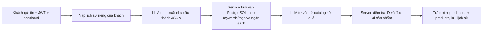

# Cơ chế tư vấn sản phẩm

Khách nhắn “Tôi cần giày nam dưới 700 nghìn”. AI đọc cả tin mới lẫn lịch sử phiên, chuyển nhu cầu thành từ khóa, đối tượng sử dụng và giới hạn giá. ProductService dùng các tiêu chí đó để tìm sản phẩm đang bán, còn hàng trong PostgreSQL. Việc tìm kiếm dùng tham số SQL; AI không có quyền thực thi SQL tùy ý.

Server đưa tối đa 12 sản phẩm tìm được cho AI. System Instruction yêu cầu chỉ tư vấn trong catalog này, hỏi thêm nếu chưa rõ nhu cầu và trả JSON `{ text, productIds }`. Nếu không tìm thấy sản phẩm, server trả lời chưa có lựa chọn phù hợp và mời khách điều chỉnh tiêu chí.

Server kiểm tra ID trả về có thuộc catalog hay không, đọc lại giá/tồn kho và đính kèm sản phẩm thật. ID lạ hoặc dữ liệu vừa thay đổi khiến lời tư vấn bị loại bỏ. Các thông tin trên thẻ sản phẩm phải lấy từ trường `products`, không suy ra từ lời thoại tự do.

Lịch sử lưu riêng theo `userId + sessionId` trong Redis hoặc Memory, tối đa 24 tin, TTL mặc định 30 phút. Vì vậy câu tiếp theo “màu đen nhé” vẫn được hiểu cùng nhu cầu giày nam và ngân sách trước đó. JWT phải khớp userId; cùng một session không xử lý hai tin đồng thời.

Đây là cơ chế truy xuất dữ liệu kết hợp system prompt và bộ nhớ hội thoại, không phải fine-tuning. Tìm kiếm hiện dùng keywords/tags, chưa dùng vector. Kiểm tra máy chủ bảo đảm ID và dữ liệu sản phẩm đính kèm; độ chính xác của mọi câu văn tự do vẫn phụ thuộc model. Checkout luôn kiểm tra lại tồn kho trong transaction.
