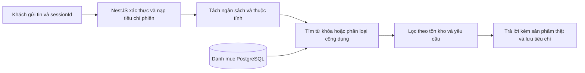

# Chat tư vấn sản phẩm chạy cục bộ

## Huấn luyện

[`intent-training.json`](../src/ai/intent-training.json) chứa 48 mẫu câu tiếng Việt có nhãn cho 12 nhóm công dụng. [`intent-model.ts`](../src/ai/intent-model.ts) chuẩn hóa chữ có dấu, tạo đặc trưng từ đơn và cặp từ liền nhau, rồi tính vector trung bình cho mỗi nhãn khi NestJS nạp module. Khi nhận câu hỏi, mô hình dùng độ tương đồng cosine để chọn nhãn. Mô hình chỉ chọn khi điểm đủ cao và tách biệt với nhãn đứng thứ hai.

Để dạy một cách diễn đạt mới, thêm mẫu câu vào mảng của nhãn tương ứng, chạy `npm test` rồi build và khởi động lại NestJS. Tên nhãn dùng làm cụm từ tra danh mục. Đây là mô hình phân loại nhỏ, giới hạn ở nhu cầu mua hàng. Những loại sản phẩm ngoài bộ huấn luyện vẫn tìm được nếu tên hoặc từ khóa xuất hiện trong danh mục.

## Xử lý hội thoại

1. `POST /api/ai/chat` nhận `userId`, `sessionId`, `message`. JWT xác định chủ phiên.
2. Parser nhận diện ngân sách như `dưới 500k`, `1,5 triệu`, `từ 300k đến 600k` cùng màu và đối tượng sử dụng. Câu “màu đen nhé” bổ sung tiêu chí trong cùng phiên.
3. Server đọc danh mục đang bán từ PostgreSQL và ưu tiên khớp tên, danh mục, mô tả hoặc tags. Nếu không khớp trực tiếp, mô hình thử suy ra loại sản phẩm từ công dụng. Danh mục demo đủ nhỏ để chấm điểm trên máy chủ.
4. Server lọc lại theo tồn kho và yêu cầu, rồi trả `{ sessionId, text, productIds, products }` với tối đa ba sản phẩm. Lời thoại lấy tên và giá từ dữ liệu đã đọc. Khi chưa rõ nhu cầu hoặc hết lựa chọn phù hợp, chat hỏi thêm.
5. Memory hoặc Redis lưu tiêu chí và tối đa 24 tin theo tài khoản và phiên. Thời gian hết hạn mặc định là 30 phút sau lượt thành công gần nhất.

## Kịch bản demo

- Mở chat sau khi đăng nhập và gửi “Giày nam dưới 700 nghìn”. Tiếp tục với “màu đen nhé”.
- Tạo phiên mới và gửi “Nghe nhạc riêng tư dưới 1 triệu” để xem nhận diện nhu cầu theo công dụng.
- Gửi “thời tiết hôm nay thế nào” trong phiên mới để xem chat hỏi lại loại sản phẩm.
